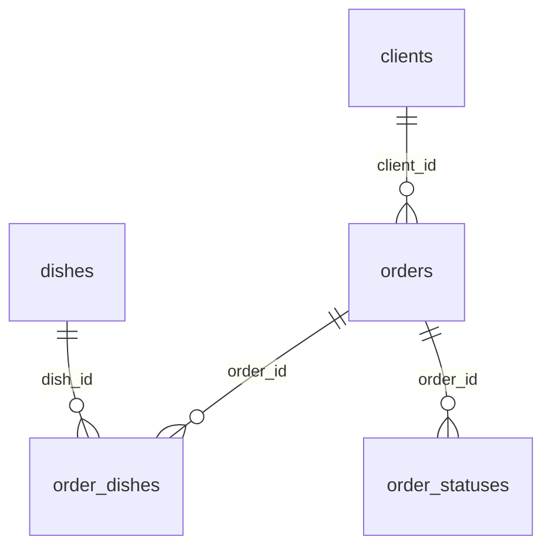

# Orders — базовая схема БД

PostgreSQL 16. Одна кухня. Базовая модель без истории цен, доставки и
диспетчеризации.

Документ фиксирует только исходный набор таблиц и связей. Всё остальное
(адреса, доставка, категории, смены и назначения курьеров, история цен)
добавляется позже отдельными миграциями.

## Принципы

- Время — `timestamptz` (UTC), деньги — `numeric(12,2)`.
- `order_statuses` — append-only история статусов заказа: строки не
  обновляются и не удаляются.
- `meta` — контекст события статуса, а не снимок заказа.
- Курьер пока не привязан к заказу: это следующее расширение модели.
- Стоимость в заказе (`order_dishes.cost`) фиксируется на момент оформления
  и не зависит от будущих изменений `dishes.cost`.

## ER-диаграмма



## Таблицы

| таблица | описание | поля |
|---|---|---|
| блюда | хранит список всех блюд | <ul><li>dish_id</li><li>name</li><li>description</li><li>cost</li></ul> |
| курьеры | хранит список всех курьеров | <ul><li>courier_id</li><li>name</li><li>telephone</li></ul> |
| клиенты | хранит список всех клиентов | <ul><li>client_id</li><li>name</li><li>telephone</li></ul> |
| заказы | хранит список всех заказов | <ul><li>order_id</li><li>created_at</li><li>client_id</li></ul> |
| список блюд в заказе | хранит список всех блюд в связке с заказами; связь M:N | <ul><li>order_id</li><li>dish_id</li><li>cost</li></ul> |
| статусы заказов | append-only таблица, хранит историю заказа | <ul><li>order_id</li><li>status</li><li>created_at</li><li>meta</li></ul> |

В DDL ниже те же таблицы названы `dishes`, `couriers`, `clients`, `orders`,
`order_dishes`, `order_statuses`. `order_dishes` — связка «заказ ↔ блюдо»
(M:N), а не 1:N; пара `(order_id, dish_id)` уникальна.

## DDL

```sql
CREATE TABLE dishes (
    dish_id     BIGSERIAL PRIMARY KEY,
    name        TEXT NOT NULL,
    description TEXT,
    cost        NUMERIC(12,2) NOT NULL
);

CREATE TABLE couriers (
    courier_id BIGSERIAL PRIMARY KEY,
    name       TEXT NOT NULL,
    telephone  TEXT NOT NULL
);

CREATE TABLE clients (
    client_id BIGSERIAL PRIMARY KEY,
    name      TEXT NOT NULL,
    telephone TEXT NOT NULL
);

CREATE TABLE orders (
    order_id   BIGSERIAL PRIMARY KEY,
    created_at TIMESTAMPTZ NOT NULL DEFAULT now(),
    client_id  BIGINT NOT NULL REFERENCES clients(client_id) ON DELETE RESTRICT
);

CREATE TABLE order_dishes (
    order_id BIGINT NOT NULL REFERENCES orders(order_id) ON DELETE CASCADE,
    dish_id  BIGINT NOT NULL REFERENCES dishes(dish_id) ON DELETE RESTRICT,
    cost     NUMERIC(12,2) NOT NULL,
    PRIMARY KEY (order_id, dish_id)
);

CREATE TABLE order_statuses (
    order_id   BIGINT NOT NULL REFERENCES orders(order_id) ON DELETE CASCADE,
    status     TEXT NOT NULL,
    created_at TIMESTAMPTZ NOT NULL DEFAULT now(),
    meta       JSONB NOT NULL DEFAULT '{}'::jsonb,
    PRIMARY KEY (order_id, created_at)
);
```

`order_statuses` не содержит суррогатного ключа: в базовой модели хватает
пары `(order_id, created_at)`. Если появятся два события с одинаковой
меткой времени, добавляется `order_status_id`.

## Связи между таблицами

| Связь | Кардинальность | FK / правило |
|---|---|---|
| `clients` → `orders` | 1:N | `client_id`, `RESTRICT` |
| `orders` → `order_dishes` | 1:N | `order_id`, `CASCADE` |
| `dishes` → `order_dishes` | 1:N | `dish_id`, `RESTRICT` |
| `orders` → `order_statuses` | 1:N | `order_id`, `CASCADE` (append-only) |

`couriers` пока ни с чем не связана.

## Индексы и ограничения

- `orders(client_id)` — история заказов клиента.
- `order_dishes(dish_id)` — PK покрывает `order_id`.
- PK `order_statuses(order_id, created_at)` покрывает выборку истории заказа.
- `CHECK` на равенство `order_dishes.cost` цене меню не ставится: это снимок
  цены на момент заказа.

## Что не входит в базу

Добавляется позже, отдельными миграциями:

- привязка курьера к заказу и история назначений;
- адреса и доставка;
- категории меню;
- история изменения цен блюд;
- платежи, скидки и промо.
